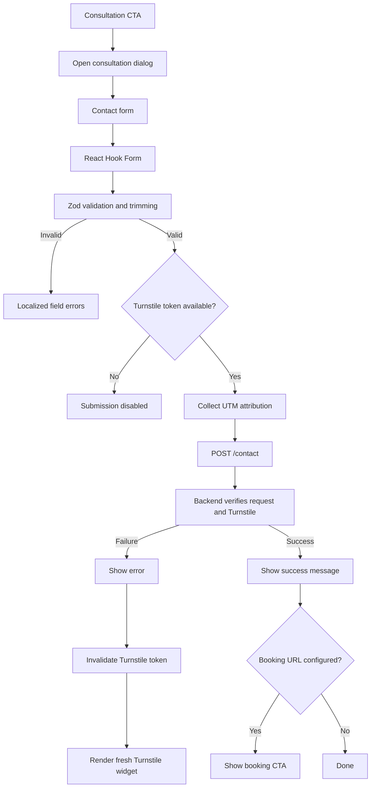
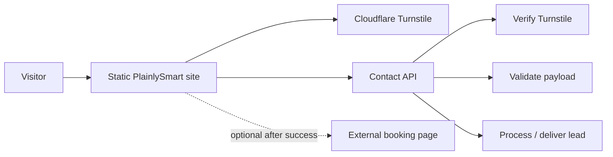

# PlainlySmart

A responsive, statically exported marketing site built with Next.js App Router, React, TypeScript, Tailwind CSS 4, Motion, and next-intl.

Product illustrations are lightweight CSS and SVG, with no external image or font requests.

The site supports English and Czech, dark/light themes, localized metadata, a shared consultation dialog, Cloudflare Turnstile protection, campaign attribution, and an external contact API.

## Run locally

```sh
npm install
npm run dev
```

Open:

```text
http://localhost:3000
```

In development and in the exported site, `/` redirects in the browser to the appropriate localized route such as `/en`, preserving the query string and hash.

The static entry page also provides a link and a no-JavaScript refresh fallback.

Useful commands:

```sh
npm run lint
npm run typecheck
npm run build
npm start
```

`npm run build` creates a static export in:

```text
out/
```

Deploy that directory to a static host. No Next.js server is required.

The host should:

- resolve extensionless paths such as `/en` to `/en.html`
- serve `404.html` for missing pages

`npm start` previews the exported site locally using `serve` on port `3000`.

## Environment variables

The contact flow uses public build-time environment variables:

```env
NEXT_PUBLIC_API_BASE_URL=https://api.example.com
NEXT_PUBLIC_TURNSTILE_SITE_KEY=your-turnstile-site-key
NEXT_PUBLIC_BOOKING_URL=https://your-booking-provider.example.com
```

### `NEXT_PUBLIC_API_BASE_URL`

Base URL of the contact API.

The frontend submits contact requests to:

```text
POST {NEXT_PUBLIC_API_BASE_URL}/contact
```

For example:

```text
POST https://api.plainlysmart.com/contact
```

### `NEXT_PUBLIC_TURNSTILE_SITE_KEY`

Public Cloudflare Turnstile site key used by the browser.

The corresponding Turnstile **secret key must never use a `NEXT_PUBLIC_` environment variable**. It belongs only on the backend where submitted tokens are verified with Cloudflare.

If the API URL or Turnstile site key is missing, contact form submission is disabled and the visitor is shown the configured fallback message.

### `NEXT_PUBLIC_BOOKING_URL`

Optional HTTPS URL shown after a successful contact submission.

This can point to a Google Calendar booking page or another scheduling service.

If it is not configured, the contact submission still works; the booking CTA simply is not displayed.

## Contact flow

All consultation CTAs open a shared native `<dialog>`.

The form collects:

- name
- email
- optional phone number
- project/message description
- optional marketing consent

There is no company field.

Form state is managed with **React Hook Form**, while validation and normalization are handled by **Zod**.

Strings are trimmed before submission and validated against their configured maximum lengths.

The form deliberately uses:

```tsx
<form noValidate>
```

so localized Zod validation messages are used instead of browser-specific validation messages.

Validation errors are connected to their respective inputs with `aria-invalid` and `aria-describedby`.



## Contact request

A successful frontend submission sends JSON similar to:

```json
{
  "name": "Jane Example",
  "email": "jane@example.com",
  "phone": "+420123456789",
  "message": "We need a customer portal.",
  "marketingConsent": false,
  "utmSource": "google",
  "utmMedium": "cpc",
  "utmCampaign": "software",
  "locale": "en",
  "turnstileToken": "..."
}
```

The request uses:

```text
Content-Type: application/json
```

and has a client-side timeout of 35 seconds.

The frontend treats the submission as successful only when:

- the HTTP response is successful, and
- the JSON response contains:

```json
{
  "success": true
}
```

The backend remains responsible for validating all submitted data again. Frontend Zod validation must not be treated as a security boundary.

## Cloudflare Turnstile

Cloudflare Turnstile is loaded explicitly from Cloudflare's JavaScript API.

The React `Turnstile` component:

- loads the Cloudflare script
- renders the widget using `window.turnstile.render(...)`
- passes successful tokens back to the contact form
- clears expired tokens
- clears invalid tokens after errors
- removes the widget when the component/effect is disposed
- recreates the widget after failed contact submissions
- uses the current site locale for the challenge UI

The frontend uses the Turnstile action:

```text
contact
```

The backend should verify both the submitted Turnstile token and the expected action.

Turnstile is an anti-bot layer, not a replacement for backend validation, rate limiting, logging, or infrastructure-level protection.

## UTM attribution

The site captures standard campaign parameters:

```text
utm_source
utm_medium
utm_campaign
utm_content
utm_term
```

They are converted to:

```text
utmSource
utmMedium
utmCampaign
utmContent
utmTerm
```

Values are trimmed and limited to 200 characters.

Campaign values are persisted for the current browser session under:

```text
plainlysmart.utm
```

using `sessionStorage`.

If browser storage is unavailable, an in-memory fallback is used for the lifetime of the loaded page/application.

Existing stored attribution is restored first. UTM values explicitly present in the current URL overwrite previously stored values.

For example:

```text
/en?utm_source=google&utm_campaign=plainlysmart
```

produces approximately:

```json
{
  "utmSource": "google",
  "utmCampaign": "plainlysmart"
}
```

These values are submitted with the contact request.

## Browser tests

Run:

```sh
npm test
```

The test suite builds the static export and serves it locally automatically.

It checks `/`, `/en`, and `/cs` for console errors and uncaught JavaScript exceptions during loading and basic interaction.

Tests use Microsoft Edge on Windows.

On other platforms, install Chromium once with:

```sh
npx playwright install chromium
```

Failed tests retain a Playwright trace under:

```text
test-results/
```

Theme and language tests cover:

- saved and system themes before hydration
- theme persistence across locale changes and reloads
- blocked browser storage
- keyboard interaction
- mobile interaction
- URL and history preservation
- localized content
- localized metadata
- language detection

The root route `/` uses:

1. the explicitly saved language preference
2. a supported browser language
3. English as the fallback

Locale cookies are intentionally ignored.

Run the theme and language suites directly with:

```sh
npx playwright test tests/theme.spec.ts tests/language-switcher.spec.ts
```

Contact/consultation tests should cover both locales, shared CTA triggers, required fields, optional phone, validation, successful and failed submissions, dialog focus behavior, and responsive widths.

## Project structure

Key areas include:

```text
src/
├── app/
│   ├── [locale]/
│   │   └── localized pages and metadata
│   └── globals.css
│
├── components/
│   ├── interactive.tsx
│   ├── booking.tsx
│   ├── Turnstile.tsx
│   └── motion/
│
├── i18n/
│   └── locale routing and request configuration
│
└── lib/
    ├── contact-tracking.ts
    └── booking.ts

messages/
├── en.json
└── cs.json
```

Responsibilities:

- `src/app/[locale]` — localized pages and metadata
- `src/components/interactive.tsx` — responsive navigation and interactive page controls
- `src/components/booking.tsx` — consultation dialog and contact form
- `src/components/Turnstile.tsx` — Cloudflare Turnstile integration
- `src/lib/contact-tracking.ts` — UTM capture and session persistence
- `src/lib/booking.ts` — consultation/capacity configuration
- `src/app/globals.css` — responsive visual system with Tailwind CSS 4
- `src/i18n` — locale routing and next-intl request configuration
- `messages/en.json` — English content, metadata, form labels and validation messages
- `messages/cs.json` — Czech content, metadata, form labels and validation messages

If the remaining `booking`-named files are renamed to reflect the current consultation/contact flow, update this section accordingly.

## Localization

English and Czech use the same application structure with separate next-intl message catalogs.

Supported localized routes include:

```text
/en
/cs
```

Each route receives the appropriate HTML language and localized metadata.

Explicit locale URLs take precedence over automatic language detection.

The user's language preference is stored client-side rather than in locale cookies.

Both localization catalogs should contain all contact form labels, validation errors, submission states, Turnstile-related fallback messaging, and consultation copy.

## Consultation dialog

Consultation CTAs throughout the application share one dialog through React Context.

The context exposes the operation for opening the consultation dialog so deeply nested CTA components do not need the dialog callback passed through multiple intermediate components.

The dialog itself owns:

- opening and closing
- body scroll locking
- focus behavior provided by the native `<dialog>`
- creation of a fresh contact-form instance on each opening

The contact form separately owns:

- React Hook Form state
- Zod validation
- Turnstile verification
- contact API submission
- API result state
- UTM attribution

This keeps the dialog lifecycle separate from form behavior.

## Static architecture

The frontend remains completely static.

Dynamic behavior such as contact submission is handled by external APIs rather than Next.js server routes.

A typical deployment architecture is:



A future AWS implementation can expose the contact endpoint through infrastructure such as API Gateway and Lambda while keeping the frontend statically hosted.

Infrastructure should eventually be maintained as code rather than relying on manual console configuration. AWS CDK with TypeScript is a suitable option if the AWS backend is introduced.

## Content notes

The two-week estimate refers to an agreed initial prototype scope, not delivery of a completed complex software product.

The site should not use invented:

- customer logos
- testimonials
- performance statistics
- customer counts
- case-study outcomes

unless they are backed by real data.
